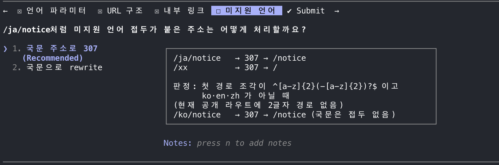

# 미지원 언어 접두가 붙은 주소의 처리 선택지

> Source: User-provided screenshot, Image #1
> Collected: 2026-10-13
> Published: 2026-10-13
> Scope: 원본 이미지와 화면에 보이는 질문·선택지·설명 상자의 전사입니다. 실제 배포된 동작을 검증한 기록은 아닙니다.



```text
/ja/notice처럼 미지원 언어 접두가 붙은 주소는 어떻게 처리할까요?

1. 국문 주소로 307 (Recommended)
2. 국문으로 rewrite

/ja/notice → 307 → /notice
/xx        → 307 → /

판정: 첫 경로 조각이 ^[a-z]{2}(-[a-z]{2})?$ 이고
      ko·en·zh가 아닐 때
(현재 공개 라우트에 2글자 경로 없음)
/ko/notice → 307 → /notice (국문은 접두 없음)
```
